<div align="center">

  <!-- Animated Header Banner -->
  <a href="https://github.com/siddharthskyhub">
    
  </a>

  <br/><br/>

  <!-- Interactive Badges & Links -->
  <p align="center">
    <a href="https://github.com/siddharthskyhub" target="_blank">
      
    </a>
    <a href="https://www.linkedin.com/in/siddharth-kumar-01a1ba296/" target="_blank">
      
    </a>
    <a href="mailto:149592035+siddharthskyhub@users.noreply.github.com" target="_blank">
      
    </a>
    
  </p>

</div>

---

### 👨‍💻 About Me

```python
class Developer:
    def __init__(self):
        self.name = "Siddharth Kumar"
        self.role = "CS Engineer | GenAI & LLM Enthusiast"
        self.focus = ["Generative AI", "Retrieval-Augmented Generation (RAG)", "Full-Stack Web Apps"]
        self.fuel = ["Coffee ☕", "Chai 🫖", "Curiosity 🚀"]

    def current_mission(self):
        return "Building practical AI applications with Python, RAG & Streamlit."
```

- 🔭 **Focus:** Building practical AI applications with Python, LangChain, RAG & Streamlit.
- 🌱 **Exploring:** Deep learning architectures, advanced agentic workflows & scalable web services.
- 💬 **Ask me about:** Python, GenAI, LLMs, RAG, Streamlit, and Full-Stack Engineering.
- ⚡ **Fun fact:** Turning coffee and chai into clean code!

---

### 🛠️ Tech Stack & Toolbox

<div align="center">

#### Languages & Core


<br/>

#### AI, Frameworks & Libraries


<br/>

#### Tools & Cloud Platforms


</div>

---

### 📊 GitHub Activity & Stats

<div align="center">
  
  
</div>

<div align="center" style="margin-top: 10px;">
  
</div>

---

### 📬 Connect With Me

<p align="center">
  <a href="https://www.linkedin.com/in/siddharth-kumar-01a1ba296/" target="_blank"></a>
  <a href="https://github.com/siddharthskyhub" target="_blank"></a>
  <a href="mailto:149592035+siddharthskyhub@users.noreply.github.com"></a>
</p>

<p align="center">
  
</p>
